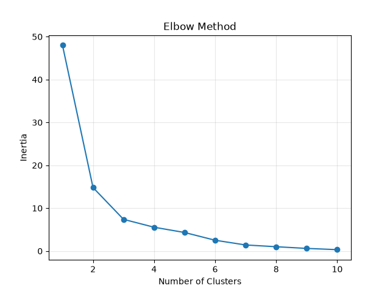
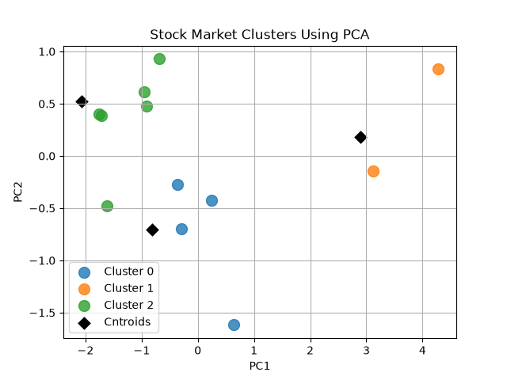

# Stock Market Segmentation 

Group 12 sample Indian stocks into risk-return clusters using K-Means and PCA

## Features Used 
AnnualIncome, Volatility, TradingVolume, PERatio

## Steps
1. Scaled data with StandardScaler
2. Tested k=2 to 10 (elbow + silhouette)
3. Applied K-Means with k=3
4. Plotted clusters and centroids using PCA

## Results
|Cluster | Return | Volatility | Type       |
|    0   | 19.5   | 22.75      | Medium risk|
|    1   | 33.5   | 43.5       | High risk  |
|    2   | 11.0   | 15.17      | Low  risk  |

Silhouette : 0.642 (k=2), 0.433 (k = 3)

## Limitations 
Data is a small hand-made sample (12 stocks), not real market data.

## How to Run 
pip install pandas matplotlib scikit-learn 
python stock-market.py

## Tech
python, pandas, Scikit-learn, matplotlib

